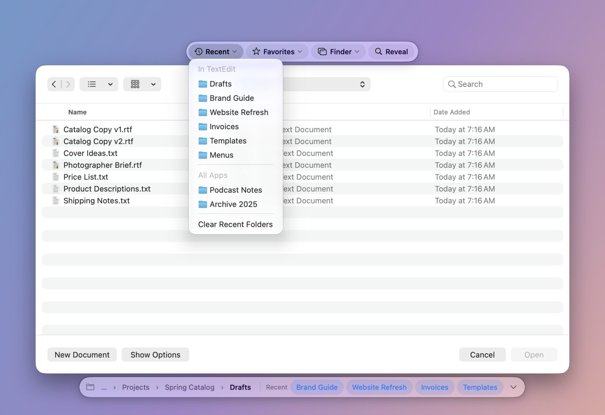
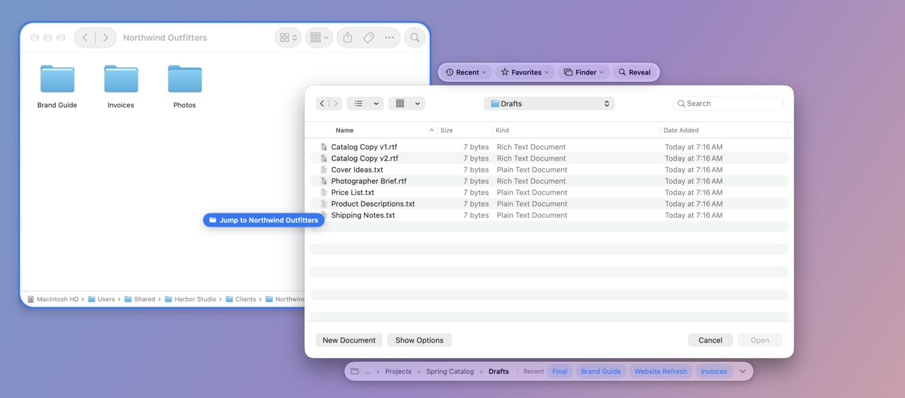
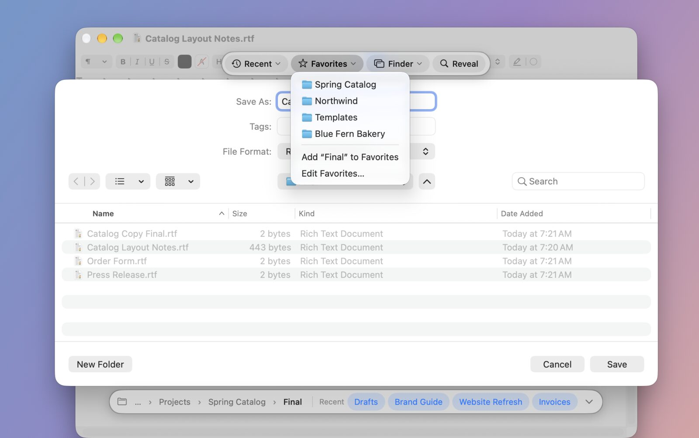
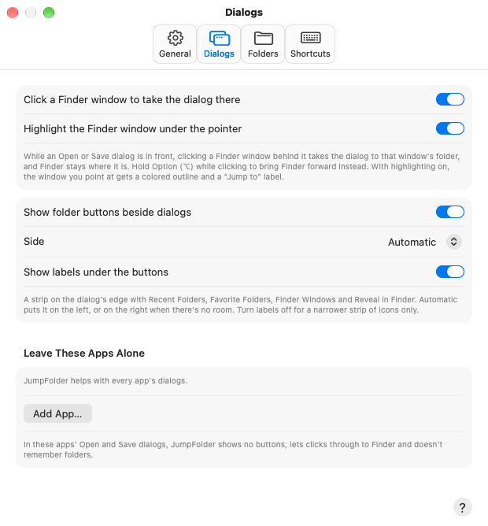

# JumpFolder

JumpFolder makes every app's Open and Save dialogs quicker. The folder you want is often already open in a Finder window, so with a dialog in front, just click that Finder window: the dialog goes to its folder and Finder stays behind. Buttons above the dialog list your recent and favorite folders and Finder's open windows, and a bar below it shows the dialog's folder path and the folders this app uses most.

<p align="center"></p>

## Download

### [⬇ Download JumpFolder for Mac](https://github.com/smanke-org/JumpFolder/releases/latest/download/JumpFolder.dmg)

1. Open `JumpFolder.dmg`.
2. Drag JumpFolder to Applications.
3. Open JumpFolder, then turn it on under System Settings › Privacy & Security › Device Control and Data Access. It needs this to see dialogs and the clicks around them.
4. The first time you click a Finder window behind a dialog, macOS asks to let JumpFolder control Finder, so it can read which folder that window shows. Click Allow.

Requires macOS 26 or later. Free.

## Features

- **Click a Finder window to jump.** With an Open or Save dialog in front, click any Finder window behind it and the dialog goes to that folder. Finder doesn't come forward, so you keep going in the dialog. Point at a Finder window first and it gets a colored outline and a "Jump to" label with its folder's name. Hold ⌥ to bring Finder forward instead.

<p align="center"></p>

- **Buttons above the dialog.** They follow the dialog as it moves and resizes, and hide when it closes.
  - **Recent**: the folders this app's dialogs used, then every app's.
  - **Favorites**: your favorite folders, plus Add to Favorites for the folder the dialog shows.
  - **Finder**: the folder of every open Finder window.
  - **Reveal**: show the dialog's folder in Finder.
- **A bar below the dialog.** The dialog's folder path (click a folder in it to go up to it), then a few folders to jump to and a chevron for the rest. Choose Recently Used, Most Used or Favorites, and how many to show. Recently Used and Most Used are kept for each app, so Excel's folders differ from Word's.
- **Per-app settings.** Give an app its own choice for the bar below, or have JumpFolder leave its dialogs alone.
- **Prefer a strip on the side?** Choose Style › Strip on the side for one column of buttons on the dialog's edge.
- **Shortcuts.** Give each list a keyboard shortcut; they work while a dialog is in front.
- **No Go to Folder flash.** JumpFolder moves the dialog by opening folders in its own list, so no sheet pops up and closes.
- **Works with your other apps.** `jumpfolder://` links for scripts and Shortcuts, buttons in ToolHUD, and its shortcuts listed in ShortcutsLens.
- **A command line for scripts and AI agents.** `jumpfolder` shows the dialog in front, takes it to a folder, and lists or changes recent folders, favorites and settings in the running app (`jumpfolder mcp` for MCP apps).
- **Settings sync.** Favorites, per-app settings, shortcuts and options follow you to your other Macs through iCloud Drive. Recent folders stay on each Mac.
- **Help built in.** ⌘? or the ? button in Settings.

<p align="center"></p>

<p align="center"> </p>

<p align="center"><sub>Every folder and file in these pictures is a made-up sample.</sub></p>

## How it works

On macOS 26 and later, Open and Save dialogs run in a separate system service, but Accessibility still shows each one as a window of the app that opened it. JumpFolder watches the app in front for that window and places its buttons around it. To take the dialog somewhere, it starts from the nearest place the dialog has a key for (Home, Desktop, Documents, Downloads, Applications, or a folder or two up) and opens one folder after another in the dialog's own list, so no Go to Folder sheet pops up. For a folder the list can't show, such as a hidden one, it falls back to the dialog's Go to Folder (⇧⌘G), typing the path and pressing Return. Finder windows don't say which folder they show through Accessibility, so JumpFolder asks Finder and matches the window you clicked by its position.

## Updates

JumpFolder checks GitHub for new versions as often as you choose (daily by default). It can install them by itself when no dialog is open, ask first, or never check. Settings › General.

## Building

```bash
swift test          # unit tests
./build_app.sh      # Developer ID signed .app in .build/app
./install.sh        # copy to /Applications and open
```

## License

© 2026 Steve Manke. All rights reserved.
